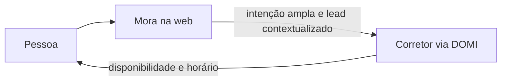
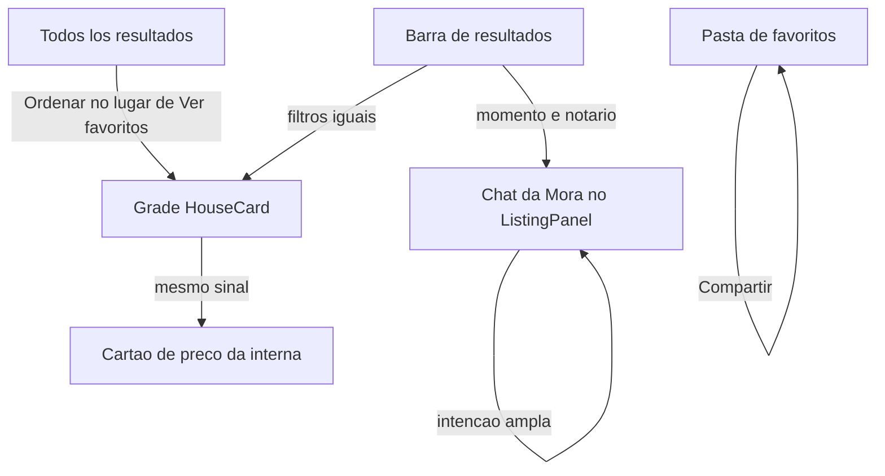

# Impactos do Classifieds 2.0 no protótipo

Fonte: rascunho de alinhamento de 16/10/2026 (Fabio Matsuda), fase 1 do Project Magdalena. O protótipo continua local e simulado. Nada disto pede backend, WhatsApp, DOMI real ou agenda.

Wireframes no produto: abrir [classifieds-2-wireframes.canvas.tsx](/Users/giovanni.alberique/.cursor/projects/Users-giovanni-alberique-Documents-inmuebles24-prototype/canvases/classifieds-2-wireframes.canvas.tsx) ao lado do chat. Sete telas, cada uma numa superfície que já existe.

## O que a fase 1 fixa

A Mora no canal de quem busca faz descoberta, qualificação de intenção e recomendação inicial. Quem negocia, marca visita e dá o atendimento da imobiliária é o corretor, via DOMI. A premissa 3 e a seção 4.2 tiram de escopo a visita em três pontas (pessoa, Mora e corretor no mesmo fio, com horário combinado).

A frase do documento que exclui “intent journeys” se lê, no protótipo, como exclusão de jornada de horário. A seção 4.3 ainda pede qualificação de intenção de compra. Intenção ampla permanece; slot de calendário sai.

## O que já conversa com o documento

- Busca híbrida: frase, filtros e Mora opcional na mesma barra. Ninguém precisa falar com a Mora para abrir um imóvel ou contatar o anunciante.
- Leitura de preço por m², bairros parecidos, mapa, colônia e entorno. Isso cobre, em versão de demonstração, pricing intelligence, neighborhood matching e contexto de rua.
- Contato simulado, sem horário reservado. [src/ContactFlow.jsx](src/ContactFlow.jsx) já diz que a visita não está agendada. [src/ListingContact.jsx](src/ListingContact.jsx) já oferece janelas amplas: esta semana, fim de semana, o quanto antes.
- O convite “No pierdas tus favoritos” no terceiro favorito ([src/Account.jsx](src/Account.jsx)) e o lead em lote a partir da pasta continuam. O documento soma pasta compartilhável e alerta; não substitui esse convite.
- Marca Inmuebles24, México, sem marketplace, pagamento ou crédito.

## Mudança que o documento pede de fato

O chat da Mora ainda orquestra um quase-agendamento. Em [src/moraChat.jsx](src/moraChat.jsx), “Quero visitar” abre grade de 4 dias (hoje + 3) e período manhã/tarde/noite, com “Pedir visita”, cartão “Hoy por la tarde” e pensamento “Revisando la agenda…”. O recorrido 3D reusa esse mesmo chat. O contrato está em [docs/FLOW.md](docs/FLOW.md), [docs/DESIGN-HANDOFF.md](docs/DESIGN-HANDOFF.md) e [docs/MORA.md](docs/MORA.md).

O grão certo, o que você descreveu, já existe no contato e não no chat:

- A Mora registra que a pessoa quer visitar e em que momento está: o quanto antes, esta semana, no fim de semana, ou sem pressa.
- Dia e hora só entram se a pessoa escrever na caixa. O texto segue na mensagem; não vira seletor.
- A confirmação deixa claro que o horário fica com a imobiliária. A Mora não propõe slot nem “revisa a agenda”.
- O mesmo vale para o botão “Agendar visita” do recorrido, que hoje cai no seletor.

Superfícies a alinhar na mesma linguagem, sem calendário: chat do mini-listing, chat do recorrido, recibo da intenção, e a cópia que cita “visitas nos últimos 7 dias” como prova de disponibilidade. Esse dado é telemetria de visita, justamente o que a fase 1 diz que a Mora não acompanha. Disponibilidade pode continuar como “o anúncio segue publicado”, sem volume de visitas.

Os chips de mensagem em [src/ListingPanel.jsx](src/ListingPanel.jsx) e [src/CompareFavorites.jsx](src/CompareFavorites.jsx) (“Visita este fin de semana”) já estão no grão certo. O lote da pasta deve continuar existindo, como lead, e a pílula “Solicitar N visitas” não deve soar como N horários marcados.

## Wireframes no produto

Sete telas. Cada uma entra numa superfície que já existe. Nada disto é tela nova, modal de laboratório ou WhatsApp.

### 1. Grade + Ordenar — [src/ResultsFlowPage.jsx](src/ResultsFlowPage.jsx)

A home Holofote e o trilho de filtros da Mora não mudam. Ordenar **não** entra na barra. Entra no heading da grade, no canto onde hoje está “Ver favoritos”.

Hoje a linha é `Todos los resultados` + contador à esquerda e o link laranja sublinhado `compare-favorites-link` à direita. Esse link sai. No lugar fica o controle de ordenar, no mesmo padrão dos filtros da barra: `mora-filter` (16/600, chevron, popover `HomePopover` em listbox). O rótulo mostra o critério ativo, por exemplo “Precio justo”. Opções: Recomendados (padrão atual, encaixe exato primeiro) · Precio justo · Rareza · Más contactos recientes. A grade não perde anúncio; só troca a ordem.

Favoritos continuam pelo coração, pelo “Ver pasta” do aviso de salvo e, com conta, pelo menu do avatar. Não ficam órfãos só porque o link do heading saiu.

Ao trocar a ordenação, a entrada dos cards toca de novo. É o mesmo ciclo que já existe quando a busca muda em [src/ResultsFlowPage.jsx](src/ResultsFlowPage.jsx): 320 ms de `is-updating` (esqueleto) e depois `flow-result-in` 450 ms, com delay `var(--result-order) * 24ms` nos oito primeiros. Incluir o sort nessa assinatura, ou remountar o grid, para a animação não ser pulada quando o conjunto de ids é o mesmo. Com movimento reduzido, o estado final, como hoje.

No `HouseCard`, o sinal de ordenação é a tag já existente na foto (cápsula 11px, máximo 2). Quem ordenou por precio justo vê “Por debajo de la mediana”. Não é um selo novo no card.

`Avisarme` não mora nesse canto. Continua na busca, no item 6.

### 2. Visita na Mora — [src/moraChat.jsx](src/moraChat.jsx), reusado pelo recorrido

Hoje, “Quiero visitar el inmueble” abre grade de 4 dias + Mañana/Tarde/Noche e o pensamento “Revisando la agenda…”. Isso sai.

No mesmo chat, no mesmo painel, a Mora pergunta o momento: Lo antes posible · Esta semana · El fin de semana · Sin prisa. O campo aberto continua. Se a pessoa escrever “sábado a las 11”, o texto vai na mensagem; não vira calendário. “Enviar intención” deixa claro que o horário fica com a imobiliária.

O formulário de contato da interna ([src/ListingContact.jsx](src/ListingContact.jsx)) já tem esta semana / fim de semana / o quanto antes e permanece.

### 3. Dúvida de mercado — chat do imóvel e barra

Antes da primeira mensagem, os chips do chat passam a incluir: ¿Cuánto cobra el notario? · ¿Qué garantía piden? · ¿Puedo comprar con crédito?

A Mora responde com faixa ilustrativa (ex.: escritura 4–7% do valor na CDMX) e o rodapé “Referencia ilustrativa”. Não mexe nos filtros. Fato que o anúncio não publica continua “a confirmar” e pode ir para a imobiliária no cartão que já existe.

A mesma pergunta na barra, sem imóvel aberto, dá a mesma resposta. Não abre listing.

### 4. Momento de quem busca — a mesma barra da pergunta de home office

Não é a janela de visita de um anúncio. Depois de uma pausa nos resultados, a Mora pergunta uma vez: “¿Quieres mudarte pronto o todavía estás viendo?” Lo antes posible · En los próximos meses · Solo estoy explorando · Ahora no. Ignorar segue a busca.

Só em compra, depois: “¿Ya tienes crédito, vas de contado, o aún no llegas a eso?” Nada é aprovado.

Histórico de visita não se pergunta. Se nesta sessão a pessoa já sinalizou visita em outros anúncios, o lead simulado conta: “Ya señaló visita en 2 anuncios.”

Exemplo de linha no lead: “Compra en Narvarte, se mudaría en los próximos meses, crédito aún abierto.”

### 5. Sinal no imóvel — tag na foto do card, linha sob o preço na interna

Não é um selo Premium nem um badge novo no sistema. São duas peças que o produto já tem, com o mesmo texto:

- **Na grade.** A tag que já existe na foto do `HouseCard` (`discovery-tag`, cápsula 11px, como “Match perfecto” ou “Bajó de precio”). Continua no limite de 2. Quem ordenou por precio justo vê “Por debajo de la mediana”. Se Match perfecto já ocupou um slot, o sinal de preço pega o segundo; tags menores (Anuncio nuevo) cedem.
- **Na interna.** Não vai cápsula no cartão de preço. Vai uma linha de apoio, no mesmo tipo e cor da taxa de condomínio que já está ali (`pp-card-fee`, 14px `#6a6a6a`): logo abaixo de `$4,200,000 MXN`, “Por debajo de la mediana de Narvarte Poniente”, depois a linha do mantenimiento, depois os dois botões. É uma frase, não um chip.

A régua de $/m² da Mora, mais abaixo na página, continua. O mini-listing já tem essa leitura; não ganha uma segunda tag no veredito.

### 6. Login — [src/Account.jsx](src/Account.jsx) e pasta

O convite do terceiro favorito (“No pierdas tus favoritos”, fotos em leque, Iniciar sesión / Ignorar) permanece.

Dentro da pasta, **Compartir** gera um link local. Abrir neste navegador mostra a pasta. Sem e-mail.

Na busca, **Avisarme** abre o login simulado se ainda não entrou. Depois, o chip vira “Te avisamos si entra algo así” no header. Sem disparo real.

### 7. Rua, prioridade baixa — campo de ubicación e Smart Input

“Calle Arquímedes” vira token. A grade fica com os anúncios cuja `home.street` contém essa rua. O mapa enquadra os pins aproximados.

Rua que o catálogo não tem: a Mora diz que não há anúncio e oferece a colônia, no mesmo gesto das sugestões de bairro. Sem Street View e sem outro recorrido 3D.

## O que não entra neste protótipo

- Jornada de WhatsApp, Bianca na fase 1 e deep link de volta para a web. O nome Mora na web já é o momento em que o documento troca a identidade.
- Portal do anunciante, DOMI OS, repasse real de lead e cobrança pay-per-lead.
- Visita confirmada, três pontas no mesmo fio, ou a Mora escolhendo sábado às 11.
- Reordenar a home Holofote. A ordenação nova vale para a grade de resultados.

Nenhuma alteração de código nesta leitura. A leva, quando você mandar executar, segue a ordem dos todos: visita, respostas de mercado, ordenação, login e, por último, a rua.
